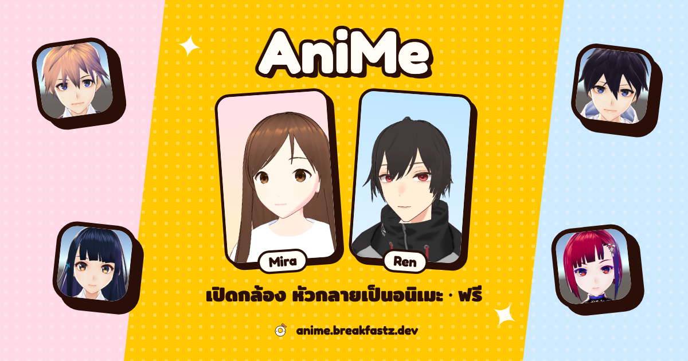
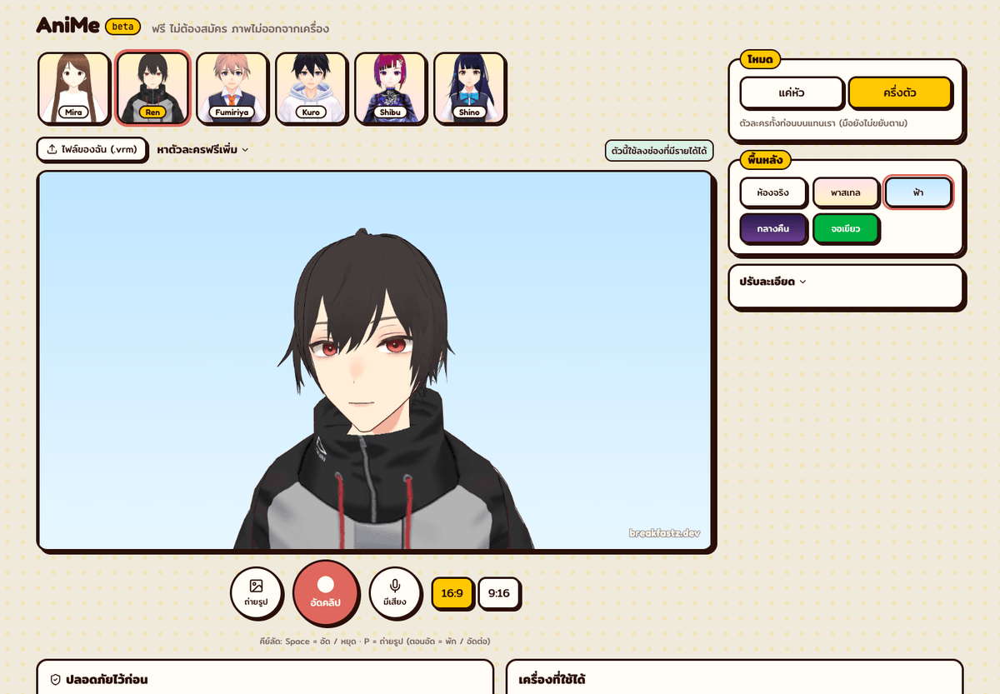
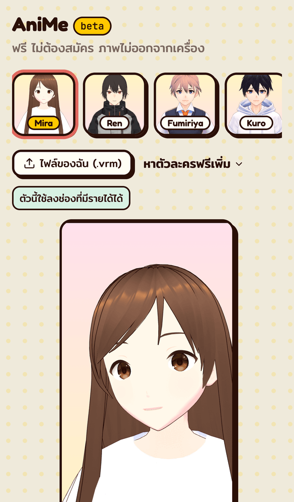
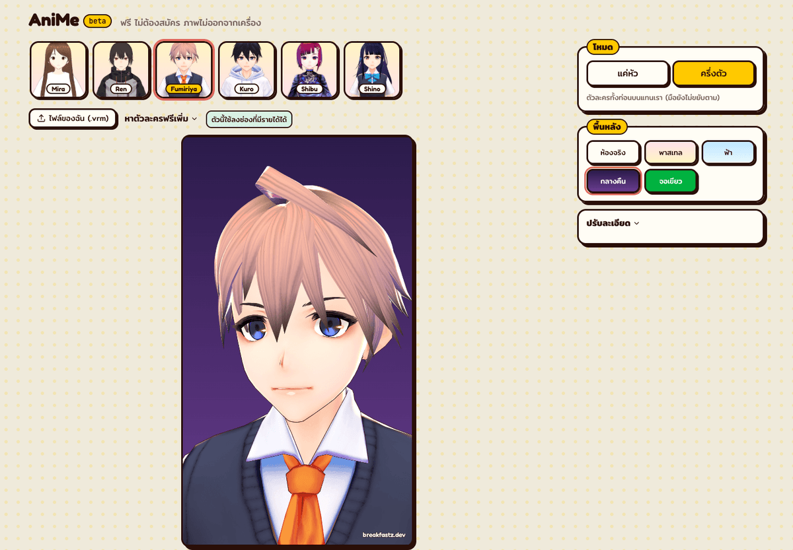

# AniMe



Your webcam, but you're an anime character, just the head or the whole upper body.

**Try it free: https://anime.breakfastz.dev** · no sign-up · **everything runs in your browser; no image ever leaves your device.**

| Desktop | Phone (9:16) |
|---|---|
|  |  |



## What it does

- **Half body** (default): an anime upper body replaces you; your real self is erased from the room.
- **Head only:** an anime head on your real body, so your hands and gestures stay yours.
- Blinks, talks, smiles and looks around with you; hair swings.
- 6 characters to pick from (male and female), or load your own `.vrm`.
- Photos and clips in 16:9 or 9:16 (1080×1920) with your mic; pause and resume while recording; save or share straight to apps on phones.
- Backgrounds: your room, pastel, sky, night, or a green screen.
- Privacy guard: if your face leaves the frame, the camera picture blurs.

> Works best on a computer (Chrome, Edge, Safari) or a recent phone. Older or low-end phones may stutter or not run at all.

Made for the [breakfastz](https://breakfastz.dev) channel, EP.006.

## How it works

```
webcam → MediaPipe Face Landmarker ─┬─ facial transformation matrix → head pose
                                    ├─ 52 blendshapes → VRM expressions + eye look
                                    └─ iris landmarks → one-off calibration (eye position, face size)
       → MediaPipe Image Segmenter (half body / fun backgrounds) → cut you out of the room
three.js + three-vrm draws the VRM with a camera matching MediaPipe's (63° vertical FOV),
so the pose matrix applies as-is. The scene is in metres so VRM spring bones behave.
2D canvas composites background + you (or the room) + avatar + watermark → preview, PNG, MediaRecorder
```

- **Any VRM, head only:** triangles mostly skinned to the head bone are kept (`src/lib/headOnly.ts`), so mesh names don't matter. Long hair can be cut at a height.
- **Half body:** the body turns a little with your head; neck and head take the rest. The real you is replaced by a clean plate of the room (3-2-1 capture, or learned from pixels that aren't you).
- **Privacy guard:** whenever the face is lost (or before calibration) the camera picture is blurred.
- **License check:** the model's own VRM license is shown (monetised use allowed? credit needed?).

## Run

```sh
bun install
bun run dev      # allow the camera
bun run test
bun run build    # static site in dist/ (Cloudflare Pages)
```

## Characters

Bundled in `public/avatars/` (textures shrunk to ≤1024 px with `scripts/slim-models.mjs`):

| file | name in app | license |
|---|---|---|
| `ren.vrm` | Ren | VRoid Studio sample "AvatarSample_C" by pixiv: free for commercial and non-commercial use, no credit required, may be redistributed free of charge (not CC0; selling the file is prohibited) |
| `fumiriya.vrm` | Fumiriya | CC0: VRoid Studio sample "Sakurada Fumiriya" by pixiv |
| `hairmale.vrm` | Kuro | CC0: VRoid Studio sample "HairSample_Male" by pixiv |
| `pixiv.vrm` | Mira (default, preloaded with the page) | VRM Public License 1.0: `VRM1_Constraint_Twist_Sample` by pixiv Inc. ([three-vrm](https://github.com/pixiv/three-vrm)); commercial use and redistribution allowed, no credit required |
| `shibu.vrm` | Shibu | CC0: VRoid Studio sample "Darkness Shibu" by pixiv |
| `shino.vrm` | Shino | CC0: VRoid Studio sample "Sendagaya Shino" by pixiv |

The CC0 files and AvatarSample_C came from [madjin/vrm-samples](https://github.com/madjin/vrm-samples); the license is also stored in each file's VRM meta.

Make your own for free in [VRoid Studio](https://vroid.com/en/studio), or find more on [VRoid Hub](https://hub.vroid.com/), [Open Source Avatars](https://www.opensourceavatars.com/) and Booth. Always read a model's license before using it.

## Credits

- [MediaPipe](https://ai.google.dev/edge/mediapipe) Face Landmarker + Image Segmenter (Apache-2.0); `face_landmarker.task` and `selfie_segmenter.tflite` are in `public/models/`
- [three.js](https://threejs.org/) (MIT) · [@pixiv/three-vrm](https://github.com/pixiv/three-vrm) (MIT)

## License

Code: MIT. Characters: see the table above.
